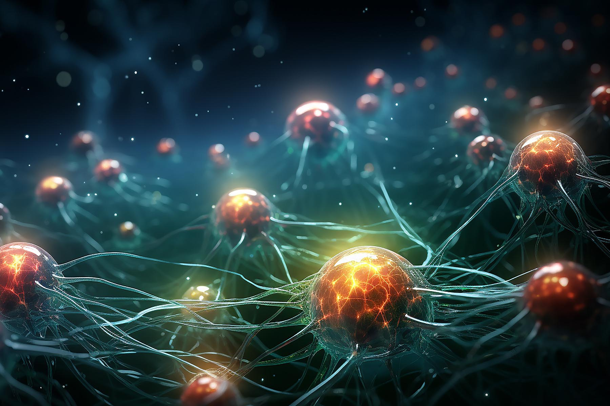

Purdue Mechanical Engineering featured our research story **"New machine learning method turbocharges heat transfer simulations"**. The work accelerates first-principles phonon scattering and thermal conductivity calculations by up to two orders of magnitude, and is released in the open-source [FourPhonon](/open_source_code/1_FourPhonon) package.

Read more at [Purdue News](https://engineering.purdue.edu/ME/News/2024/new-machine-learning-method-turbocharges-heat-transfer-simulations).

The follow-up GPU work was also featured: [FourPhonon simulations now 26 times faster with GPU acceleration](https://engineering.purdue.edu/ME/News/2026/fourphonon-simulations-now-26-times-faster-with-gpu-acceleration).

Papers: [ML prediction (npj Comput. Mater. 2023)](https://www.nature.com/articles/s41524-023-01020-9), [sampling acceleration (npj Comput. Mater. 2024)](https://www.nature.com/articles/s41524-024-01215-8).
