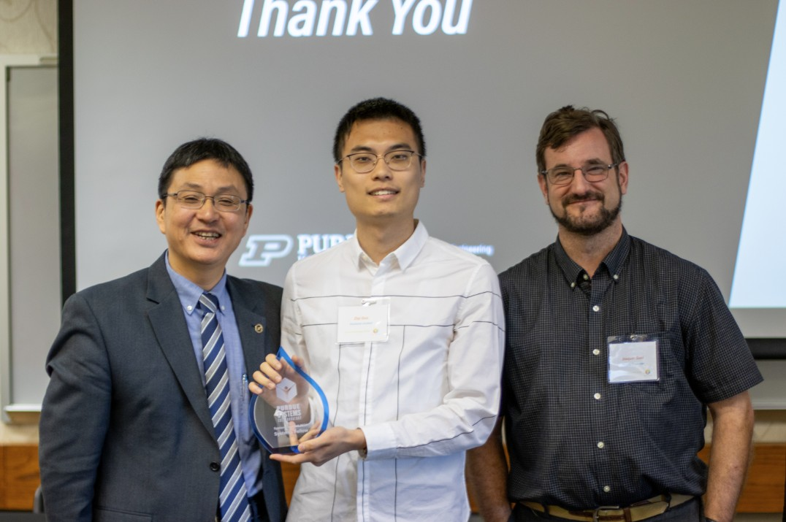

I was selected as a **Systems Fellow** at the Purdue Systems Collaboratory. The Systems Fellows Program supports my interdisciplinary research at the intersection of scientific computing and machine learning.

Media posts: [LinkedIn 1](https://www.linkedin.com/posts/purdue-systems-collaboratory-85898b223_systemsfellow-innovation-systemsthinking-activity-7289652805122854912-AR1m/), [LinkedIn 2](https://www.linkedin.com/posts/purdue-systems-collaboratory-85898b223_we-are-thrilled-to-introduce-our-new-systems-activity-7242641625477193728-Fcd5)

