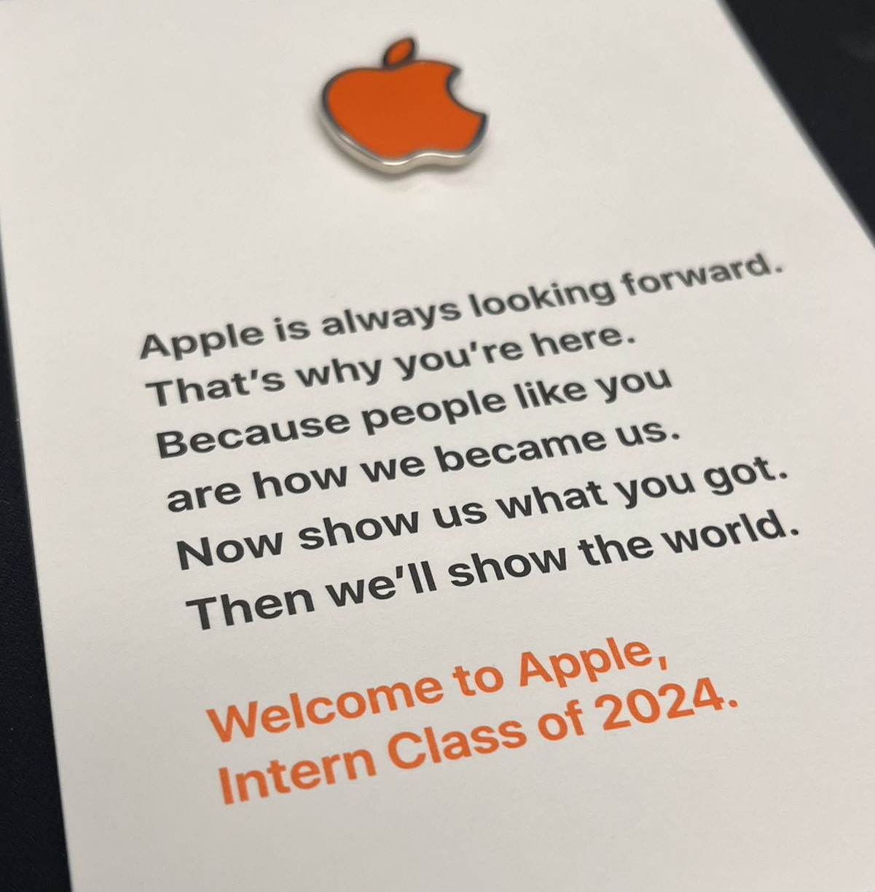

I spent summer 2024 (May to Aug.) as a research intern on the Apple battery team (Algorithm & Machine Learning). Two key projects:

- **Efficient numerical solvers** for an on-device physics-based lithium-ion battery model, achieving **16x faster simulation** and enabling simulation under dynamic operating conditions, to better understand transport phenomena in batteries.
- **Machine learning for user-behavior forecasting**: a statistical model on time-series data that **improved prediction accuracy by 50%** over the existing on-device model.

I later joined Apple full-time (June 2025) as a Machine Learning Researcher in battery modeling and simulation.

