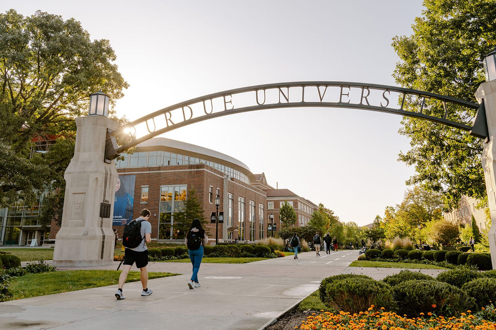

I received the **Warren and Judy Stevenson Scholarship**, awarded for outstanding research in applied optics. The scholarship is granted to only three students each year.

Media post: [LinkedIn](https://www.linkedin.com/posts/guo-ziqi_congratulations-to-all-the-purdue-me-graduate-activity-7276091084567429120-nlcA)

