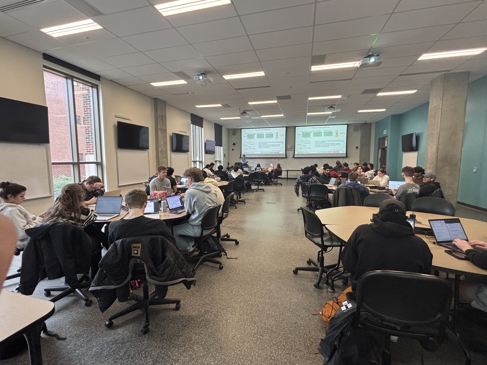

I was invited as a guest speaker for **SYS 350: Systems Methods** at Purdue University in Spring 2025. My talk, *"Integrating AI, High-Performance Computing (HPC), and Multiscale Physics for Solving Energy Transport Problems,"* was part of the course. Thanks to the course instructors and students for the engaging discussion!

