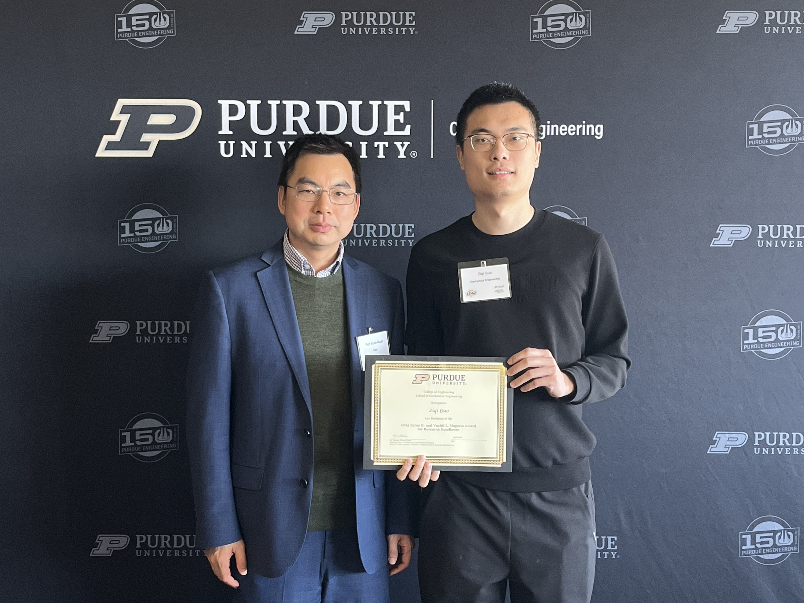

I received the **Magoon Research Excellence Award** from Purdue University, given for outstanding research performance and limited to four students annually.

Media post: [LinkedIn](https://www.linkedin.com/posts/guo-ziqi_after-taking-home-the-graduate-student-gold-activity-7318404475394670592-2K3Y)

