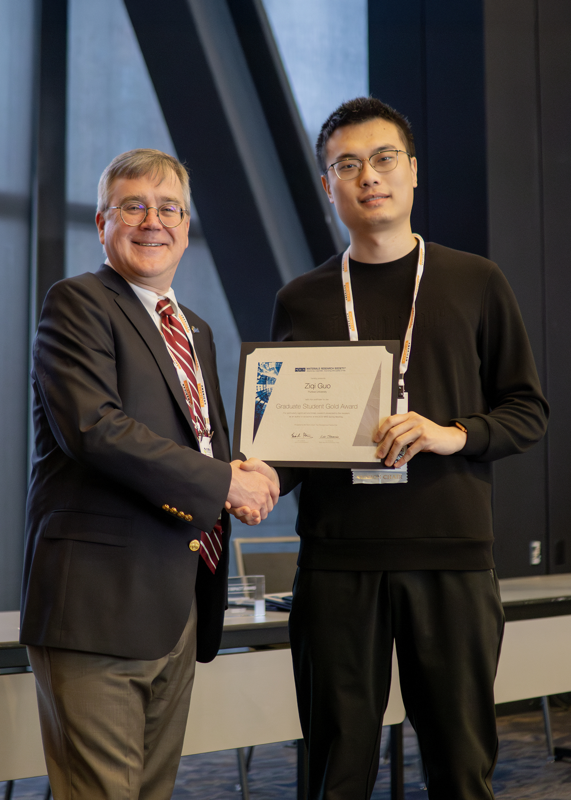

I received the **Graduate Student Gold Award** at the 2025 Materials Research Society (MRS) Spring Meeting & Exhibit, the highest recognition MRS gives to graduate students. I was also honored to serve as a session chair of Symposium SF01: *Thermal Transport in Materials*.

Media posts: [MRS website](https://www.mrs.org/advancing-careers/award-central/spring-awards/graduate-student-awards/past-recipients), [LinkedIn 1](https://www.linkedin.com/posts/purdue-engineering_past-recipients-activity-7318619251487977473-ZEwY), [LinkedIn 2](https://www.linkedin.com/posts/guo-ziqi_past-recipients-activity-7317042194274496515-PoQL)

