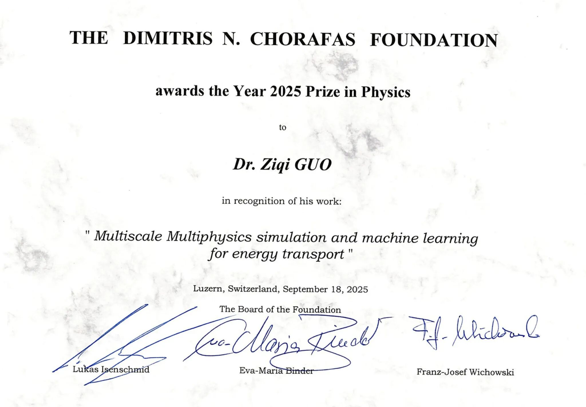

I am honored to be a recipient of the **2025 Dimitris N. Chorafas Foundation Award** for my research in physics and AI. It is a highly selective global recognition given to only about 20 researchers worldwide each year.

Media post: [LinkedIn](https://www.linkedin.com/posts/purdueme_physics-ai-researchaward-activity-7399492153309057024-vkHX)

