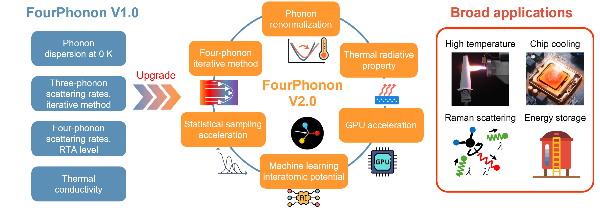

**FourPhonon** is a Boltzmann transport equation (BTE) and phonon scattering solver built on the [ShengBTE](http://www.shengbte.org/) platform. It computes three- and four-phonon scattering rates in crystals, solves the linearized phonon BTE exactly, and outputs lattice thermal conductivity. The four-phonon formalism was developed by the [Ruan group](https://engineering.purdue.edu/NANOENERGY/) at Purdue.

**[GitHub repository](https://github.com/FourPhonon/FourPhonon)** · **[Manual](https://github.com/FourPhonon/FourPhonon/blob/main/Manual.md)** · License: GPL-3.0

## Why acceleration matters

Phonon scattering calculations are the computational bottleneck of first-principles thermal transport. Four-phonon processes are especially expensive, which makes high-throughput screening of thermal properties and large-system calculations difficult. My contributions to FourPhonon (machine learning prediction, statistical sampling, and GPU acceleration) target this bottleneck, with up to ~100× speedup from ML and up to 26× overall from GPUs.

## Media

- [New machine learning method turbocharges heat transfer simulations](https://engineering.purdue.edu/ME/News/2024/new-machine-learning-method-turbocharges-heat-transfer-simulations), Purdue Mechanical Engineering
- [FourPhonon simulations now 26 times faster with GPU acceleration](https://engineering.purdue.edu/ME/News/2026/fourphonon-simulations-now-26-times-faster-with-gpu-acceleration), Purdue Mechanical Engineering

*Supported by the NSF CSSI Elements program (award #2311848).*
