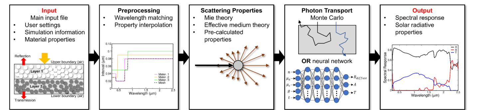

*FOS* means "light" in Greek. It is an open-source program for **F**ast **O**ptical **S**pectrum calculations of nanoparticle media: you provide material properties and a description of the system, and it returns the spectral reflectance, absorptance, and transmittance.

**[GitHub repository](https://github.com/FastOpticalSpectrum/FOS)** · **[Paper (Comput. Phys. Commun. 307, 109393)](https://www.sciencedirect.com/science/article/abs/pii/S0010465524003163)** · **[Video tutorial](https://www.youtube.com/watch?v=fCwUsdP4lq8)** · License: GPL-3.0

## Why FOS

Earlier open-source codes each cover only one piece of the problem (Mie theory *or* a Monte Carlo solver). FOS integrates the full pipeline in one program, and speeds it up with compiled Python, parallel processing, and pre-trained machine-learning predictions. This makes optimization and high-throughput design of nanoparticle or nanocomposite media practical, for example radiative cooling paints, solar heating liquids, lunar dust coatings, and combustion particulates.

## How it works

1. **Input:** a main input file with user settings, simulation information, and material properties (wavelength in µm, n, k).
2. **Preprocessing:** wavelength matching and interpolation of material properties onto a common mesh.
3. **Scattering properties:** Mie theory (including core–shell particles and size distributions) plus effective-medium theory, or user-supplied pre-calculated properties.
4. **Photon transport:** Monte Carlo simulation, or a pre-trained deep neural network that predicts the diffuse reflectance, absorptance, and transmittance directly.
5. **Output:** the spectral response and solar radiative properties (solar reflectance, absorptance, transmittance when a solar spectrum is provided), together with plots.

## Features

- Multiple layers, multiple particle types, and core–shell particles
- Custom optical properties and optional size distributions
- Boundary conditions (air or a user-defined substrate)
- Windows executable (no Python needed) and a Python module (`main_func('input.txt', True/False)`) for scripting and optimization loops

## Getting started

```bash
git clone https://github.com/FastOpticalSpectrum/FOS.git
cd FOS
pip install -r requirements.txt   # Python 3.10
python Main3.py
```

On Windows you can instead download `FOS.exe` from the latest release.

## Related work

For multi-layer media, see our follow-up [*Overcoming the curse of dimensionality: Enabling multi-layer photon transport with recurrent neural network*](https://arxiv.org/abs/2509.22890): an RNN surrogate about 700× faster than Monte Carlo with under 1% error.

## Citation

D. Carne, J. Peoples, Z. Guo, D. Feng, Z. Han, X. Liu, X. Ruan, *FOS: A fully integrated open-source program for Fast Optical Spectrum calculations of nanoparticle media*, Computer Physics Communications 307, 109393 (2025). [doi:10.1016/j.cpc.2024.109393](https://doi.org/10.1016/j.cpc.2024.109393)
